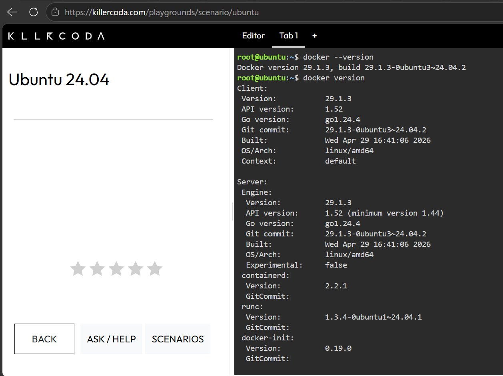
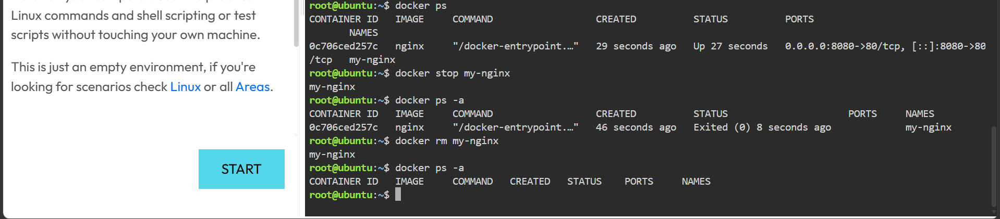

# Laboratory 04: The Cloud-Native Engineer

## Mission Overview
In this mission I acted as a Cloud-Native Engineer at CloudNova Technologies. I compared Virtual Machines and Containers, then used a KillerCoda Docker environment to deploy and manage a containerized Nginx web server.

## Objectives
- Differentiate between Virtual Machines and Containers
- Access a Docker-enabled environment using KillerCoda
- Execute fundamental Docker CLI commands
- Pull, run, manage and terminate an Nginx container
- Document container operations using Markdown
- Continue building my GitHub Cloud Computing Portfolio

## Docker Commands Executed
**Checkpoint 3**
- `docker --version`
- `docker version`
- `docker info`

**Checkpoint 4**
- `docker pull nginx`
- `docker run -d --name my-nginx -p 8080:80 nginx`
- `curl http://localhost:8080`

**Checkpoint 5**
- `docker ps`
- `docker stop my-nginx`
- `docker ps -a`
- `docker rm my-nginx`

## Skills Learned
- Explaining the architectural differences between VMs and containers
- Pulling images and running containers in detached mode
- Mapping ports between host and container
- Managing the container lifecycle (run, stop, remove)
- Writing technical documentation in Markdown

## Challenges Encountered
- (Isulat mo dito ang totoong naranasan mo, halimbawa: pagkalito sa port mapping, paghihintay na mag-load ang KillerCoda, o pag-upload ng screenshots sa GitHub.)

## Screenshots

