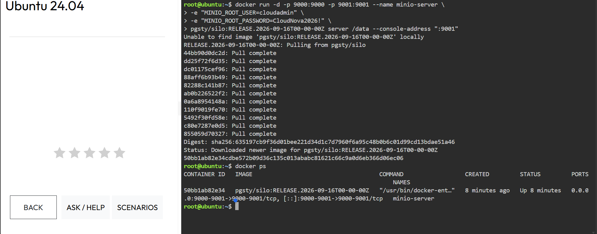
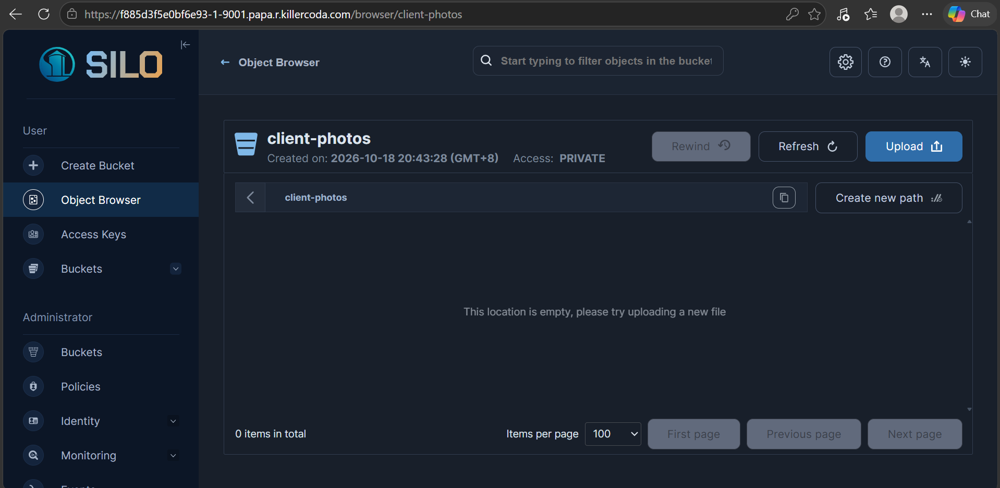

# MinIO Deployment

## Docker Command Used

```bash
docker run -d -p 9000:9000 -p 9001:9001 --name minio-server \
-e "MINIO_ROOT_USER=cloudadmin" \
-e "MINIO_ROOT_PASSWORD=CloudNova2026!" \
pgsty/silo:RELEASE.2026-09-16T00-00-00Z server /data --console-address ":9001"
```

Verified with:

```bash
docker ps
```

## Deployment Details

| Item | Value |
|---|---|
| Web Console Port | 9001 |
| API Port | 9000 |
| Container Name | minio-server |
| Image | pgsty/silo:RELEASE.2026-09-16T00-00-00Z |
| Bucket Created | client-photos |

## Explanation of the `-e` Flags

The `-e` flag sets environment variables inside the container when it starts.

- `MINIO_ROOT_USER=cloudadmin` sets the administrator username used to log in to the web console.
- `MINIO_ROOT_PASSWORD=CloudNova2026!` sets the administrator password for that account.

Without these variables, the server would use default credentials, which is insecure.

## Other Flags

- `-d` runs the container in the background (detached mode).
- `-p 9000:9000` exposes the S3 API port.
- `-p 9001:9001` exposes the web console port.
- `--name minio-server` gives the container a readable name.
- `server /data` starts the object storage server and stores its data in `/data`.
- `--console-address ":9001"` serves the web console on port 9001.

## Steps Performed

1. Launched a KillerCoda Ubuntu Playground.
2. Tried `minio/minio` and `quay.io/minio/minio`, but both failed because MinIO removed its community images from Docker Hub and restricted Quay.
3. Deployed MinIO using `pgsty/silo`, a community fork still available on Docker Hub, and verified it with `docker ps`.
4. Opened port 9001 through the Traffic / Ports tab to access the web console.
5. Logged in with the credentials set in the Docker command.
6. Created the `client-photos` bucket and uploaded a test file.

## Screenshots



